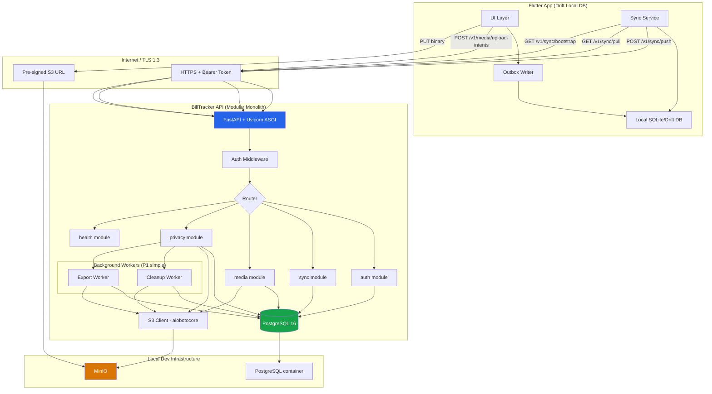
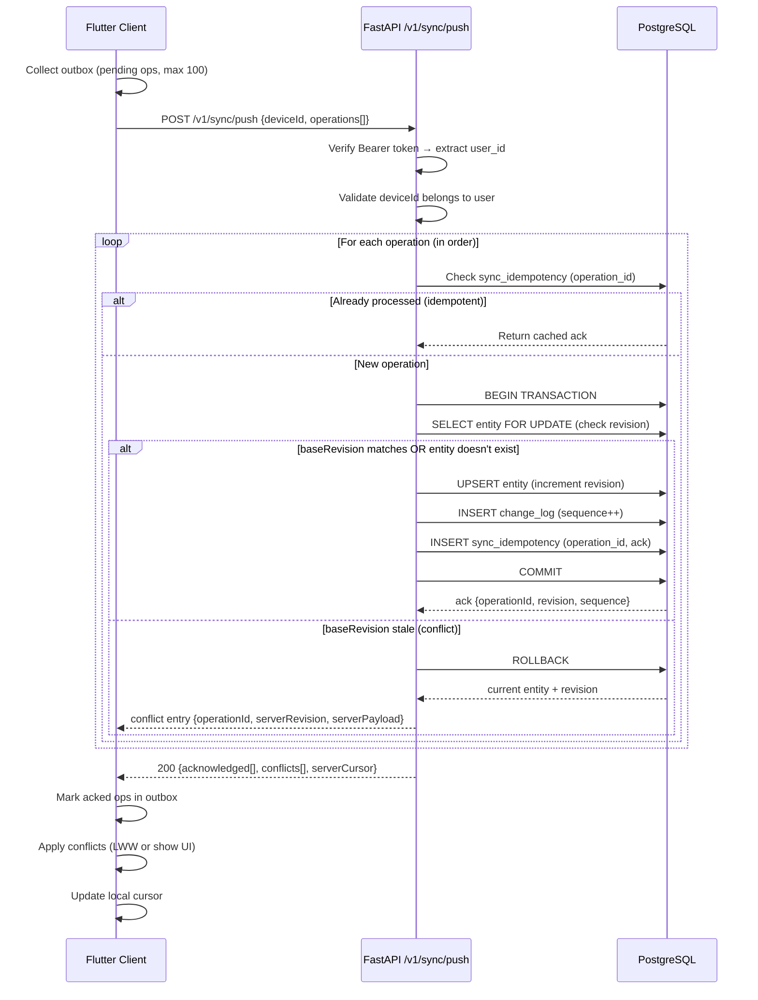
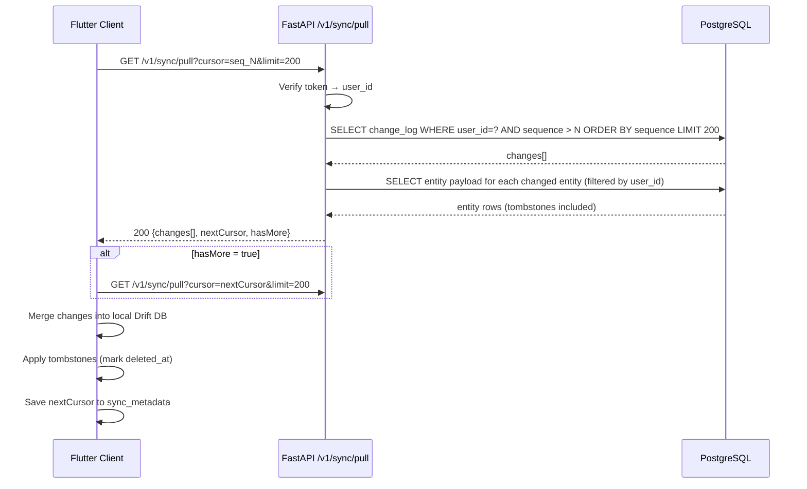
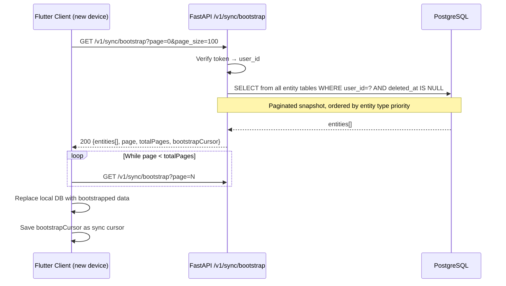

# BillTracker Backend — Architecture Document (P1: Cloud Backup & Sync)

> **Ngày:** 2026-09-12  
> **Tác giả:** Lead Backend Engineer  
> **Phạm vi:** P1 — Cloud Backup & Sync (modular monolith, local-first, opt-in)

---

## 1. Lý do chọn stack

### 1.1. Quyết định kiến trúc tổng thể: Modular Monolith

| Tiêu chí | Modular Monolith ✅ | Microservices ❌ |
|---|---|---|
| Team size hiện tại | Phù hợp (1–3 engineers) | Overhead vận hành cao |
| Domain boundary | Rõ theo module (auth, sync, media, privacy) | Quá sớm để tách |
| Deployment | Docker Compose đủ, không cần K8s | Cần orchestration phức tạp |
| Transaction integrity | DB transaction native (ACID) | Distributed saga phức tạp |
| Observability | Single service dễ trace | Multi-service correlation overhead |
| Tách module sau | Có thể tách khi thật sự cần | Khó merge lại nếu cắt sai |

**Quyết định:** Bắt đầu modular monolith. Contract API (`/v1`) không thay đổi khi tách service sau. Mỗi module có folder riêng, không import chéo ngoài qua interface/service layer.

### 1.2. Language & Framework

| Lựa chọn | Lý do |
|---|---|
| **Python 3.12** | Async native (asyncio), ecosystem phong phú cho AI/ML (P2), team phổ biến |
| **FastAPI** | ASGI, auto OpenAPI, Pydantic native, async first, performance tốt cho I/O bound |
| **SQLAlchemy 2.0 async** | Mature ORM, async engine, type-safe queries, tích hợp Alembic tốt nhất |
| **Alembic** | Migration versioned, rollback có, tích hợp SQLAlchemy |
| **Pydantic v2** | Validation nhanh (Rust core), schema generation, strict mode |

### 1.3. Database & Storage

| Lựa chọn | Lý do |
|---|---|
| **PostgreSQL 16** | ACID, JSONB, range types, row-level security, mature, cursor-based sync với `sequence` native |
| **Không dùng Redis P1** | Không có hot cache pattern thực sự cần thiết; sync idempotency lưu trong Postgres đủ. Thêm Redis P2/P3 khi rate-limit cần distributed counter hoặc session store cần TTL fast-path |
| **MinIO (local) / S3-compatible** | Object storage private bucket, pre-signed URL, SSEC, lifecycle rule. Interface chuẩn boto3/aiobotocore |

### 1.4. Infrastructure (Local Dev)

| Thành phần | Tool |
|---|---|
| Container | Docker Compose 3.9+ |
| Object storage dev | MinIO |
| Process management | uvicorn + gunicorn (prod) |
| Background jobs | Python asyncio task queue (arq) — lightweight, Redis-based, thêm P2; P1 dùng DB polling đơn giản |
| Auth dev mock | Dev-mode JWT issuer built-in (không hardcode secret production) |

---

## 2. Sơ đồ kiến trúc



### 2.1. Module structure

```
backend/
├── app/
│   ├── main.py                    # FastAPI app factory
│   ├── config.py                  # Settings (pydantic-settings)
│   ├── dependencies.py            # FastAPI dependencies (auth, db, storage)
│   ├── middleware.py              # Request ID, logging, rate limit
│   │
│   ├── modules/
│   │   ├── auth/                  # Auth module
│   │   │   ├── router.py
│   │   │   ├── service.py
│   │   │   ├── schemas.py
│   │   │   ├── models.py          # SQLAlchemy models
│   │   │   └── oidc.py            # OIDC/OAuth verifier
│   │   │
│   │   ├── sync/                  # Sync module
│   │   │   ├── router.py
│   │   │   ├── service.py
│   │   │   ├── schemas.py
│   │   │   ├── models.py
│   │   │   └── conflict.py
│   │   │
│   │   ├── media/                 # Media module
│   │   │   ├── router.py
│   │   │   ├── service.py
│   │   │   ├── schemas.py
│   │   │   ├── models.py
│   │   │   └── storage.py         # S3-compatible client
│   │   │
│   │   ├── privacy/               # Privacy & account lifecycle
│   │   │   ├── router.py
│   │   │   ├── service.py
│   │   │   └── schemas.py
│   │   │
│   │   └── health/                # Health & readiness
│   │       └── router.py
│   │
│   ├── db/
│   │   ├── base.py                # SQLAlchemy base, engine factory
│   │   ├── session.py             # Async session factory
│   │   └── models/                # All SQLAlchemy ORM models
│   │
│   └── core/
│       ├── security.py            # JWT sign/verify, token rotation
│       ├── errors.py              # Exception classes & handlers
│       ├── logging.py             # Structured logging, redaction
│       └── pagination.py          # Cursor pagination helpers
│
├── migrations/                    # Alembic
│   ├── env.py
│   ├── versions/
│   └── alembic.ini
│
├── tests/
│   ├── conftest.py
│   ├── unit/
│   └── integration/
│
├── scripts/
│   ├── seed_dev.py
│   └── export_openapi.py
│
├── docker-compose.yml
├── Dockerfile
├── .env.example
├── pyproject.toml
└── README.md
```

---

## 3. ERD (Entity-Relationship Diagram)

```mermaid
erDiagram
    users {
        TEXT id PK "ULID"
        TIMESTAMPTZ created_at
        TIMESTAMPTZ deleted_at "soft delete"
        TIMESTAMPTZ deletion_scheduled_at "null = not requested"
    }

    auth_identities {
        TEXT id PK "ULID"
        TEXT user_id FK
        TEXT provider "apple | google | dev_mock"
        TEXT provider_subject "sub from IdP"
        TIMESTAMPTZ created_at
        TIMESTAMPTZ last_used_at
    }

    devices {
        TEXT id PK "ULID"
        TEXT user_id FK
        TEXT name "display name"
        TEXT platform "ios | android"
        TEXT push_token "nullable, for P3 notifications"
        TIMESTAMPTZ created_at
        TIMESTAMPTZ last_seen_at
        TIMESTAMPTZ revoked_at "null = active"
    }

    refresh_tokens {
        TEXT id PK "ULID"
        TEXT device_id FK
        TEXT user_id FK
        TEXT token_hash "SHA-256, not stored plain"
        TEXT family "rotation family id"
        BOOLEAN used
        TIMESTAMPTZ expires_at
        TIMESTAMPTZ created_at
        TIMESTAMPTZ revoked_at
    }

    transactions {
        TEXT id PK "ULID - client-generated"
        TEXT user_id FK
        TEXT type "expense | income"
        NUMERIC amount
        TEXT currency
        TEXT category_id FK
        TEXT merchant
        TIMESTAMPTZ occurred_at
        TEXT note
        TEXT payment_method
        TEXT source "product_snap | receipt_scan | manual | import"
        TEXT status "draft | confirmed | needs_review | failed"
        INTEGER revision
        TIMESTAMPTZ updated_at
        TIMESTAMPTZ deleted_at "tombstone"
        TIMESTAMPTZ created_at
    }

    categories {
        TEXT id PK "ULID or system slug"
        TEXT user_id FK "null = system category"
        TEXT parent_id FK
        TEXT name
        TEXT icon
        INTEGER color_value
        BOOLEAN is_system
        INTEGER sort_order
        INTEGER revision
        TIMESTAMPTZ updated_at
        TIMESTAMPTZ deleted_at
    }

    budgets {
        TEXT id PK "ULID"
        TEXT user_id FK
        TEXT category_id FK
        TEXT period "monthly | weekly | custom"
        NUMERIC amount_limit
        TEXT alert_thresholds "JSON array [0.8, 1.0, 1.2]"
        BOOLEAN alert_sent_at_80
        BOOLEAN alert_sent_at_100
        TIMESTAMPTZ period_start
        TIMESTAMPTZ period_end
        INTEGER revision
        TIMESTAMPTZ updated_at
        TIMESTAMPTZ deleted_at
    }

    media {
        TEXT id PK "ULID"
        TEXT user_id FK
        TEXT transaction_id FK "nullable - before linking"
        TEXT object_key "s3 key, NOT public"
        TEXT thumbnail_key "s3 key for thumbnail"
        TEXT content_hash "SHA-256 of file"
        BIGINT size_bytes
        TEXT mime_type "validated server-side"
        TEXT media_type "product | receipt | screenshot"
        TEXT state "pending_upload | ready | deleted | error"
        INTEGER width
        INTEGER height
        TIMESTAMPTZ captured_at
        INTEGER revision
        TIMESTAMPTZ updated_at
        TIMESTAMPTZ deleted_at
        TIMESTAMPTZ created_at
    }

    receipt_extractions {
        TEXT transaction_id PK FK
        TEXT user_id FK
        TEXT merchant
        FLOAT merchant_confidence
        BOOLEAN merchant_user_edited
        TIMESTAMPTZ transaction_date
        FLOAT date_confidence
        NUMERIC total
        FLOAT total_confidence
        NUMERIC subtotal
        NUMERIC tax
        TEXT payment_method
        FLOAT overall_confidence
        BOOLEAN requires_review
        INTEGER revision
        TIMESTAMPTZ updated_at
        TIMESTAMPTZ deleted_at
    }

    receipt_line_items {
        TEXT id PK "ULID"
        TEXT transaction_id FK
        TEXT user_id FK
        TEXT name
        FLOAT quantity
        NUMERIC unit_price
        NUMERIC total
        TEXT category_suggestion
        FLOAT confidence
        INTEGER revision
        TIMESTAMPTZ updated_at
        TIMESTAMPTZ deleted_at
    }

    ai_inferences {
        TEXT id PK "ULID"
        TEXT media_id FK
        TEXT user_id FK
        TEXT model_version
        JSONB labels_json
        TEXT suggested_category_id
        FLOAT suggested_category_confidence
        JSONB extracted_amounts_json
        FLOAT confidence
        INTEGER latency_ms
        TEXT source "on_device | cloud"
        INTEGER revision
        TIMESTAMPTZ updated_at
        TIMESTAMPTZ deleted_at
        TIMESTAMPTZ created_at
    }

    change_log {
        BIGSERIAL sequence PK "auto-increment, never reuse"
        TEXT user_id FK
        TEXT entity_type "transaction | category | budget | media | receipt_extraction | receipt_line_item | ai_inference"
        TEXT entity_id
        TEXT operation "upsert | delete"
        INTEGER revision
        TEXT device_id "which device made the change"
        TIMESTAMPTZ changed_at
    }

    sync_idempotency {
        TEXT user_id
        TEXT device_id
        TEXT operation_id PK "client ULID"
        TEXT response_hash "SHA-256 of acked response"
        TIMESTAMPTZ created_at
        TIMESTAMPTZ expires_at "TTL 7 days"
    }

    export_jobs {
        TEXT id PK "ULID"
        TEXT user_id FK
        TEXT status "queued | processing | ready | failed | expired"
        TEXT download_key "s3 key when ready"
        TIMESTAMPTZ created_at
        TIMESTAMPTZ ready_at
        TIMESTAMPTZ expires_at "presigned URL TTL"
    }

    account_deletion_requests {
        TEXT id PK "ULID"
        TEXT user_id FK
        TEXT initiated_by_device FK
        TIMESTAMPTZ requested_at
        TIMESTAMPTZ scheduled_delete_at "T+30 days"
        BOOLEAN completed
        TIMESTAMPTZ completed_at
    }

    users ||--o{ auth_identities : "has"
    users ||--o{ devices : "owns"
    devices ||--o{ refresh_tokens : "has"
    users ||--o{ refresh_tokens : "issued"
    users ||--o{ transactions : "owns"
    users ||--o{ categories : "owns"
    users ||--o{ budgets : "owns"
    users ||--o{ media : "owns"
    transactions ||--o{ media : "has"
    transactions ||--o| receipt_extractions : "has"
    transactions ||--o{ receipt_line_items : "has"
    media ||--o{ ai_inferences : "analyzed by"
    categories ||--o{ transactions : "classifies"
    categories ||--o{ budgets : "constrains"
    users ||--o{ change_log : "produces"
    users ||--o{ export_jobs : "requests"
    users ||--o{ account_deletion_requests : "requests"
```

---

## 4. API Flow: Push/Pull Sync

### 4.1. Push Flow



### 4.2. Pull Flow



### 4.3. Bootstrap Flow (New Device)



---

## 5. Quy tắc Conflict / Tombstone / Idempotency

### 5.1. Conflict Resolution (P1: Last-Write-Wins)

```
Rule: server_revision > base_revision → CONFLICT (HTTP 409)

Conflict response includes:
  - conflicting operation_id
  - server_revision (current)
  - server_payload (current entity state)
  - hint: "server_wins" (P1 LWW policy)

Client action (P1):
  - Update local entity with server version
  - Show optional notification "Dữ liệu đã được cập nhật từ thiết bị khác"
  - Do NOT re-push the stale local change
```

### 5.2. Tombstone Rule

```
DELETE operation → set deleted_at = now(), increment revision
Push rule:
  - Tombstone always wins over older upsert
  - IF incoming operation is upsert AND entity has deleted_at → return 409 with tombstone payload
  - IF incoming operation is delete AND entity exists → apply tombstone regardless of baseRevision IF server_revision <= base_revision + 1

Tombstone retention: 30 days before purge
After purge: entity row deleted; change_log entry retained (without payload)
```

### 5.3. Idempotency

```
Key: (user_id, device_id, operation_id)
On push: check sync_idempotency BEFORE processing
  - If found: return cached response hash (no re-processing)
  - If not found: process and store idempotency record (TTL 7 days)

operation_id: ULID generated client-side, immutable across retries
Server MUST NOT re-process same operation_id → prevents duplicate transactions
```

### 5.4. Sequence / Cursor

```
change_log.sequence: PostgreSQL BIGSERIAL (auto-increment, monotonic, per-database)
cursor format: "seq_{sequence_number_zero_padded_18}"
  Example: "seq_000000000000000291"

Pull: WHERE user_id = ? AND sequence > {decoded_cursor}
Bootstrap cursor: max(sequence) at time of bootstrap snapshot
```

---

## 6. Threat Model & Security Decisions

### 6.1. Threat Model (STRIDE)

| Threat | Vector | Mitigation |
|---|---|---|
| **Spoofing** | Fake IdP token | Server-side OIDC verification (jwks_uri), không trust client assertion |
| **Tampering** | Modified entity payload | `revision` + DB ownership check; `content_hash` cho media |
| **Repudiation** | Deny sync operation | `change_log` immutable với `device_id`; audit event per operation |
| **Information Disclosure** | IDOR via entity ID | Row-level ownership check: `WHERE user_id = {token.sub} AND id = {param}` |
| **Information Disclosure** | Log leakage | Redact: access_token, refresh_token, pre-signed URLs, amount, merchant, rawText |
| **Denial of Service** | Sync bomb (too many ops) | Max 100 ops/push, 5 MB payload limit, rate limit per user/IP |
| **Elevation of Privilege** | userId from body | `user_id` ONLY from verified JWT sub, never from request body/query |
| **Upload bomb** | Large file upload | File size limit (20MB), quota per user, magic bytes validation |
| **Token theft** | Stolen refresh token | Refresh token rotation + family invalidation on reuse detection |

### 6.2. Auth Design

```
Access token: JWT RS256, exp=15 min
Refresh token: opaque random (stored as SHA-256 hash), exp=90 days
Rotation: each /auth/refresh issues new RT, marks old as used
Reuse detection: if used token presented → revoke entire family → force re-login
Device revoke: revoke all RTs for device
Account delete: revoke all RTs immediately
```

### 6.3. Media Security

```
- Pre-signed PUT URL: 15 min TTL, single-use path, bucket private
- Pre-signed GET URL: 5 min TTL, issued per-request, ownership verified before issuance
- Magic bytes check: server-side after upload complete (HEAD + first 16 bytes via S3)
- MIME allowlist: image/jpeg, image/png, image/heic, image/webp
- Max size: 20 MB (original), 5 MB (compressed), 200KB (thumbnail)
- Quota: configurable per user (default 2 GB P1)
- No URL logging: pre-signed URLs stripped from logs by middleware
```

### 6.4. Rate Limits (P1 — Basic)

| Endpoint | Limit |
|---|---|
| `/v1/auth/*` | 10 req/min per IP |
| `/v1/sync/push` | 30 req/min per user |
| `/v1/sync/pull` | 60 req/min per user |
| `/v1/media/*` | 20 req/min per user |
| `DELETE /v1/me` | 3 req/hour per user |
| All others | 120 req/min per user |

---

## 7. Cloud OCR P2 — Interface Placeholder

Module `ocr` được thiết kế nhưng **không triển khai** trong P1. Các interface sau được đặt sẵn:

```python
# app/modules/ocr/interface.py (P2 placeholder)

class OCRJobStatus(str, Enum):
    QUEUED = "queued"
    PROCESSING = "processing"
    COMPLETED = "completed"
    FAILED = "failed"

class CloudOCRProvider(Protocol):
    """Interface for cloud OCR backend (P2: Google Cloud Vision, Azure, etc.)"""

    async def submit_job(
        self,
        media_id: str,
        object_key: str,
        document_type: str,
        locale: str,
    ) -> str:
        """Returns job_id."""
        ...

    async def get_job_status(self, job_id: str) -> OCRJobStatus:
        ...

    async def get_job_result(self, job_id: str) -> dict:
        ...
```

Endpoints `/v1/ocr/*` trả `501 Not Implemented` với message rõ ràng trong P1.

---

## 8. Sự khác biệt: Flutter Schema vs. Cloud Schema cần cho Sync

| Flutter/Drift field | Trạng thái | Cần thêm cho Sync |
|---|---|---|
| `Transactions.id` | ✅ TEXT PK (client UUID) | Cần dùng ULID/UUIDv7 — đã đúng format |
| `Transactions.createdAt/updatedAt` | ✅ Có | Thêm `syncRevision`, `syncUpdatedAt`, `syncDeletedAt`, `syncState`, `lastSyncedAt` |
| `Categories` | ⚠️ Không có `updatedAt` | Thêm sync metadata fields |
| `Budgets` | ⚠️ Không có `updatedAt`, không có xóa mềm | Thêm sync metadata fields |
| `TransactionMedias` | ⚠️ Chỉ lưu local path | Thêm `cloudObjectKey`, `cloudState`, sync metadata |
| `ReceiptExtractions` | ⚠️ Không có `updatedAt` | Thêm sync metadata |
| `ReceiptLineItems` | ⚠️ Không có `updatedAt` | Thêm sync metadata |
| `AIInferences` | ⚠️ Không có `updatedAt` | Thêm sync metadata |
| **`SyncOutbox`** | ❌ Không có | **Tạo mới** |
| **`SyncMetadata`** | ❌ Không có | **Tạo mới** |

### Các trường cần thêm vào mọi entity đồng bộ (Drift migration):

```dart
// Thêm vào mỗi bảng đồng bộ
IntColumn get syncRevision => integer().withDefault(const Constant(0))();
DateTimeColumn get syncUpdatedAt => dateTime()();
DateTimeColumn get syncDeletedAt => dateTime().nullable()();
// 'clean' | 'pending' | 'syncing' | 'failed' | 'conflict'
TextColumn get syncState => text().withDefault(const Constant('clean'))();
DateTimeColumn get lastSyncedAt => dateTime().nullable()();
```

### Hai bảng mới cần tạo trong Drift:

```dart
// SyncOutbox
class SyncOutbox extends Table {
  TextColumn get operationId => text()(); // PK, ULID
  TextColumn get entityType => text()();  // 'transaction' | 'category' | ...
  TextColumn get entityId => text()();
  TextColumn get operation => text()();   // 'upsert' | 'delete'
  TextColumn get payloadJson => text()();
  IntColumn get baseRevision => integer()();
  DateTimeColumn get createdAt => dateTime()();
  IntColumn get retryCount => integer().withDefault(const Constant(0))();
  TextColumn get lastError => text().nullable()();
  @override Set<Column> get primaryKey => {operationId};
}

// SyncMetadata
class SyncMetadata extends Table {
  TextColumn get deviceId => text()(); // PK
  TextColumn get cursor => text().nullable()();
  DateTimeColumn get lastSuccessAt => dateTime().nullable()();
  TextColumn get lastError => text().nullable()();
  // 'none' | 'compressed' | 'compressed_and_original'
  TextColumn get mediaBackupPolicy => text().withDefault(const Constant('none'))();
  DateTimeColumn get cloudSyncConsentAt => dateTime().nullable()();
  @override Set<Column> get primaryKey => {deviceId};
}
```

> **Lưu ý quan trọng:** Các Drift migration này **không phá vỡ** offline behavior. App vẫn hoạt động đầy đủ mà không sync; các trường sync chỉ được sử dụng khi user opt-in Cloud Sync.

---

## 9. Observability

### 9.1. Structured Logging

```json
{
  "timestamp": "2026-09-12T09:30:00.123Z",
  "level": "INFO",
  "request_id": "req_01J...",
  "user_id": "usr_01J...",
  "device_id": "dev_01J...",
  "method": "POST",
  "path": "/v1/sync/push",
  "status_code": 200,
  "duration_ms": 45,
  "ops_count": 12,
  "conflicts_count": 0
}
```

**Redacted fields (không log):** `access_token`, `refresh_token`, pre-signed URLs, `amount`, `merchant`, `note`, `rawText`, `labelsJson`, `payload` content của operation.

### 9.2. Health Endpoints

- `GET /health` — liveness (HTTP 200 nếu process alive)
- `GET /health/ready` — readiness (kiểm tra DB + S3 connectivity)
- `GET /health/version` — version info, không sensitive

### 9.3. Metrics (Prometheus-compatible)

```
billtracker_sync_push_ops_total{status="acked|conflict|error"}
billtracker_sync_push_duration_seconds
billtracker_sync_pull_changes_returned
billtracker_media_upload_bytes_total
billtracker_auth_token_issued_total{provider="apple|google|dev_mock"}
billtracker_auth_token_refresh_total{result="success|reuse_detected|expired"}
```

---

## 10. Deployment (Local Dev)

```
docker compose up:
  - api:       FastAPI on :8000
  - postgres:  PostgreSQL 16 on :5432
  - minio:     MinIO S3-compatible on :9000 (console: :9001)

Commands:
  make migrate    → alembic upgrade head
  make seed       → python scripts/seed_dev.py
  make test       → pytest
  make openapi    → python scripts/export_openapi.py
```
